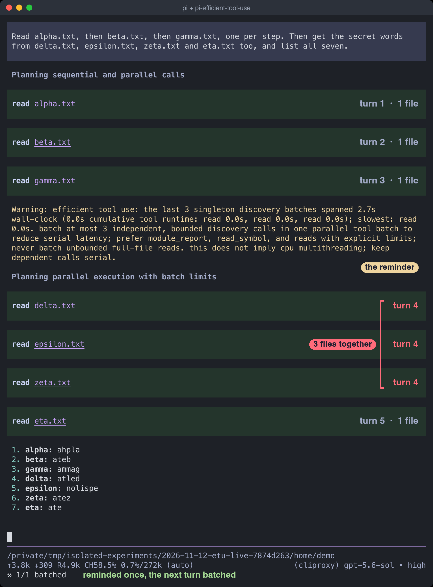
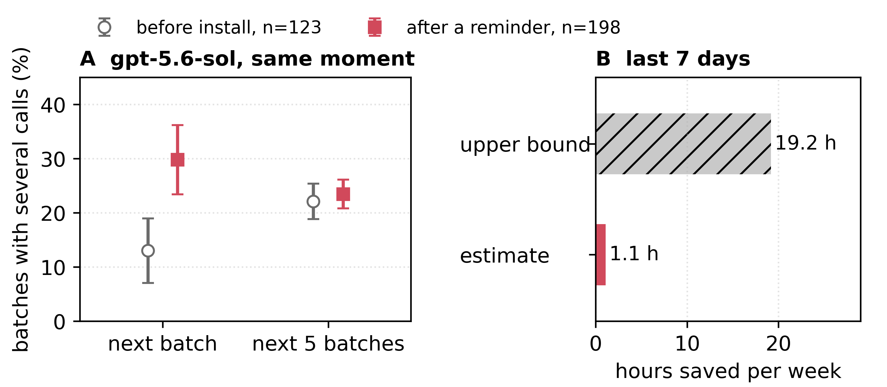

<p align="center"><b>English</b> · <a href="docs/README.zh-CN.md">简体中文</a> · <a href="docs/README.es.md">Español</a> · <a href="docs/README.ru.md">Русский</a> · <a href="docs/README.ja.md">日本語</a></p>

# pi-efficient-tool-use

Reminds a [Pi](https://github.com/earendil-works/pi) agent to send independent lookups together instead of one at a time, and shows in the footer how often that worked (`⚒ 2/3 batched`: of 3 reminders, 2 were followed by a batch of several calls). It also fixes a few wasteful tool calls where they happen.

<p align="center"></p>

```bash
pi install npm:pi-efficient-tool-use
```

## What it does

- **Batch reminder**: after three lookups in a row (read, grep, find, ls and similar) each sent alone, the last result asks the model to batch the independent ones. Lookups that use the previous result are left alone.
- **Time notice**: after 15, 30, 60 minutes and so on, tells the model how long the request has run and where the time went.
- **No recursive bash grep** when the grep tool is on: the call is refused and the grep tool is named instead.
- **Edit hint**: a sed, perl or script that rewrites a source file is pointed to the edit tool.
- **Did you mean**: a mangled tool name such as `copy_bash` gets the real name.
- **Shorter bash output**: binary output, and long runs of lines that differ only in paths or numbers, each become one line.

## Does it work?

A little. In my own Pi logs, at the moment the reminder fires (three lone lookups in a row), gpt-5.6-sol sent several calls in its next batch 13% of the time before I installed it and 30% after a reminder. Five batches later the difference is gone: the model forgets. Over a week that is about 1 hour of waiting saved, out of at most 19 hours that batching could save.

<p align="center"></p>

## Check on your own logs

```bash
npx pi-efficient-tool-use
```

It reads your Pi sessions in `~/.pi/agent/sessions` (nothing leaves your machine) and prints the same comparison per model: before install, after a reminder, and after install without one. A few thousand sessions take about two minutes.

## Development

```bash
npm install && npm test
```

## Contributing

I am still learning, so ideas, issues and pull requests are all very welcome.

## License

MIT
