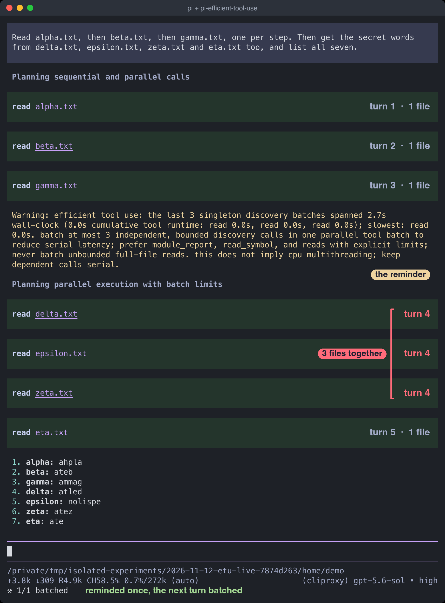

<p align="center"><a href="../README.md">English</a> · <a href="README.zh-CN.md">简体中文</a> · <b>Español</b> · <a href="README.ru.md">Русский</a> · <a href="README.ja.md">日本語</a></p>

# pi-efficient-tool-use

Recuerda a un agente de [Pi](https://github.com/earendil-works/pi) que envíe juntas las búsquedas independientes en lugar de una por una, y muestra en el pie cuántas veces funcionó (`⚒ 2/3 batched`: de 3 recordatorios, 2 fueron seguidos por un lote con varias llamadas). También corrige algunas llamadas a herramientas que desperdician tiempo, justo donde ocurren.

<p align="center"></p>

https://github.com/user-attachments/assets/e4a9c709-f00f-43d9-b4b6-634a06507758

También en [YouTube](https://youtu.be/44regQgCahw).

```bash
pi install npm:pi-efficient-tool-use
```

## Qué hace

- **Recordatorio de lotes**: tras tres búsquedas seguidas (read, grep, find, ls y similares) enviadas una a una, el último resultado pide al modelo que agrupe las independientes. Las búsquedas que usan el resultado anterior no cuentan.
- **Aviso de tiempo**: a los 15, 30, 60 minutos y así sucesivamente, le dice al modelo cuánto lleva la petición y en qué se fue el tiempo.
- **Sin grep recursivo en bash** cuando la herramienta grep está activa: la llamada se rechaza y se nombra la herramienta grep.
- **Sugerencia de edición**: un sed, perl o script que reescribe un archivo de código se redirige a la herramienta edit.
- **¿Quisiste decir?**: un nombre de herramienta deformado como `copy_bash` recibe el nombre real.
- **Salida de bash más corta**: la salida binaria y las series largas de líneas que solo difieren en rutas o números quedan en una línea cada una.

## ¿Funciona?

Un poco. En mis propios registros de Pi, en el momento en que salta el recordatorio (tres búsquedas sueltas seguidas), gpt-5.6-sol envió varias llamadas en su siguiente lote el 13% de las veces antes de instalarlo y el 30% tras un recordatorio. En una semana eso supone alrededor de 1 hora de espera ahorrada.

## Compruébalo con tus propios registros

```bash
npx pi-efficient-tool-use
```

Lee tus sesiones de Pi en `~/.pi/agent/sessions` (nada sale de tu máquina) e imprime la misma comparación por modelo: antes de instalarlo, tras un recordatorio y después de instalarlo sin recordatorio. Unos miles de sesiones tardan unos dos minutos.

## Desarrollo

```bash
npm install && npm test
```

## Contribuir

Todavía estoy aprendiendo, así que ideas, issues y pull requests son muy bienvenidos.

## Licencia

MIT
