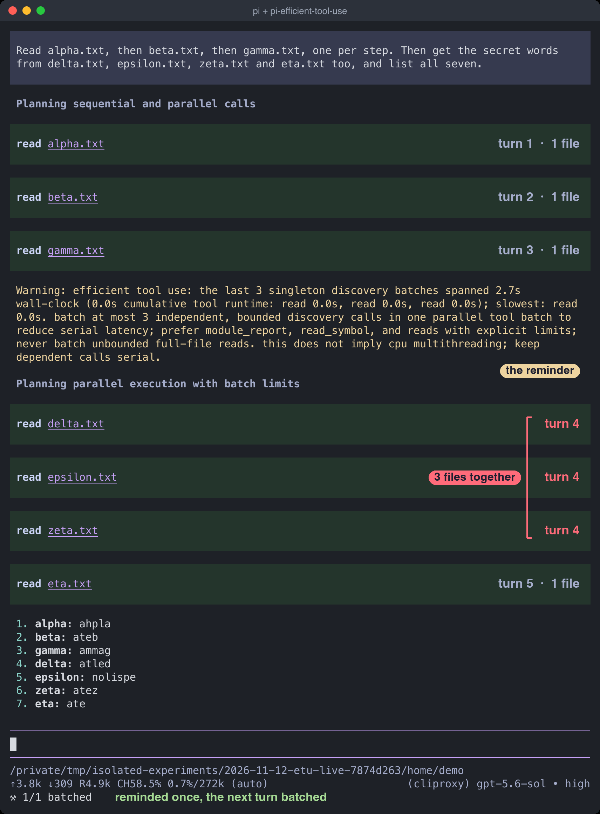

<p align="center"><a href="../README.md">English</a> · <a href="README.zh-CN.md">简体中文</a> · <a href="README.es.md">Español</a> · <a href="README.ru.md">Русский</a> · <b>日本語</b></p>

# pi-efficient-tool-use

[Pi](https://github.com/earendil-works/pi) のエージェントに、互いに依存しない検索を一つずつではなくまとめて送るよう促し、それがどれだけ効いたかをフッターに表示します（`⚒ 2/3 batched`：3 回のリマインダーのうち 2 回で、次のバッチに複数の呼び出しが入った）。あわせて、無駄なツール呼び出しのいくつかをその場で直します。

<p align="center"></p>

https://github.com/user-attachments/assets/e4a9c709-f00f-43d9-b4b6-634a06507758

[YouTube](https://youtu.be/44regQgCahw) でも見られます。

```bash
pi install npm:pi-efficient-tool-use
```

## 自分のログで確かめる

```bash
npx pi-efficient-tool-use
```

`~/.pi/agent/sessions` にある Pi のセッションを読み（何も外部に送りません）、次のバッチに複数の呼び出しが入った割合をモデルごとに表示します：導入前、リマインダー後、導入後でリマインダーなし。数千セッションで 2 分ほどかかります。

## 開発

```bash
npm install && npm test
```

## コントリビュート

まだ勉強中なので、アイデア、issue、pull request を大歓迎します。

## ライセンス

MIT
