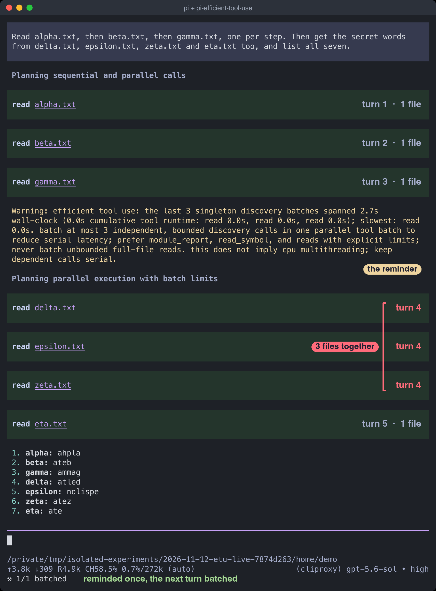

<p align="center"><a href="../README.md">English</a> · <a href="README.zh-CN.md">简体中文</a> · <a href="README.es.md">Español</a> · <b>Русский</b> · <a href="README.ja.md">日本語</a></p>

# pi-efficient-tool-use

Напоминает агенту [Pi](https://github.com/earendil-works/pi) отправлять независимые запросы вместе, а не по одному, и показывает в нижней строке, как часто это сработало (`⚒ 2/3 batched`: из 3 напоминаний после 2 следующий пакет содержал несколько вызовов). Кроме того, исправляет несколько расточительных вызовов инструментов прямо на месте.

<p align="center"></p>

https://github.com/user-attachments/assets/e4a9c709-f00f-43d9-b4b6-634a06507758

Также на [YouTube](https://youtu.be/44regQgCahw).

```bash
pi install npm:pi-efficient-tool-use
```

## Что он делает

- **Напоминание о пакетах**: после трёх запросов подряд (read, grep, find, ls и подобных), отправленных по одному, последний результат просит модель объединять независимые запросы. Запросы, которые используют предыдущий результат, не учитываются.
- **Уведомление о времени**: на 15, 30, 60 минутах и далее сообщает модели, сколько длится запрос и на что ушло время.
- **Без рекурсивного grep в bash**, если включён инструмент grep: вызов отклоняется, и вместо него называется инструмент grep.
- **Подсказка для правок**: sed, perl или скрипт, переписывающий исходный файл, направляется к инструменту edit.
- **Возможно, вы имели в виду**: искажённое имя инструмента, например `copy_bash`, получает настоящее имя.
- **Короче вывод bash**: двоичный вывод и длинные серии строк, различающихся только путями или числами, сворачиваются в одну строку каждая.

## Работает ли это?

Немного. В моих собственных логах Pi в момент срабатывания напоминания (три одиночных запроса подряд) gpt-5.6-sol отправлял несколько вызовов в следующем пакете в 13% случаев до установки и в 30% после напоминания. За неделю это около 1 часа сэкономленного ожидания.

## Проверьте на своих логах

```bash
npx pi-efficient-tool-use
```

Он читает ваши сессии Pi в `~/.pi/agent/sessions` (ничего не покидает ваш компьютер) и выводит то же сравнение по моделям: до установки, после напоминания и после установки без напоминания. Несколько тысяч сессий обрабатываются примерно за две минуты.

## Разработка

```bash
npm install && npm test
```

## Участие

Я всё ещё учусь, поэтому буду очень рад идеям, issue и pull request.

## Лицензия

MIT
