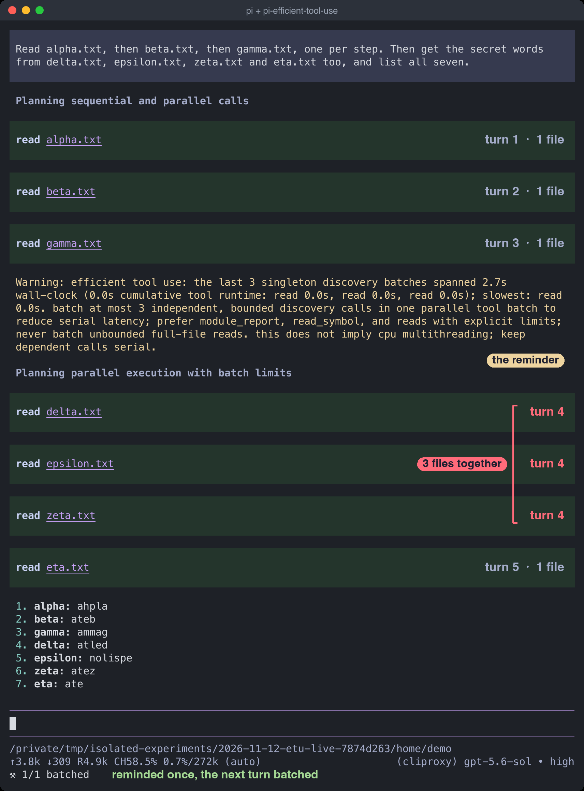

<p align="center"><a href="../README.md">English</a> · <b>简体中文</b> · <a href="README.es.md">Español</a> · <a href="README.ru.md">Русский</a> · <a href="README.ja.md">日本語</a></p>

# pi-efficient-tool-use

提醒 [Pi](https://github.com/earendil-works/pi) 智能体把互不依赖的查找一次发出，不要一个一个地发；并在底栏显示提醒的效果（`⚒ 2/3 batched`：提醒了 3 次，其中 2 次下一批同时发了多个调用）。它还会在出问题的地方顺手纠正几种浪费的工具调用。

<p align="center"></p>

https://github.com/user-attachments/assets/e4a9c709-f00f-43d9-b4b6-634a06507758

也可以在 [YouTube](https://youtu.be/44regQgCahw) 上观看。

```bash
pi install npm:pi-efficient-tool-use
```

## 在自己的日志上验证

```bash
npx pi-efficient-tool-use
```

它读取你本机 `~/.pi/agent/sessions` 里的 Pi 会话（不会上传任何内容），按模型打印下一批同时发出多个调用的比例：安装前、收到提醒后、安装后但没收到提醒。几千个会话大约需要两分钟。

## 开发

```bash
npm install && npm test
```

## 参与贡献

我还在学习中，非常欢迎任何想法、issue 和 pull request。

## 许可证

MIT
